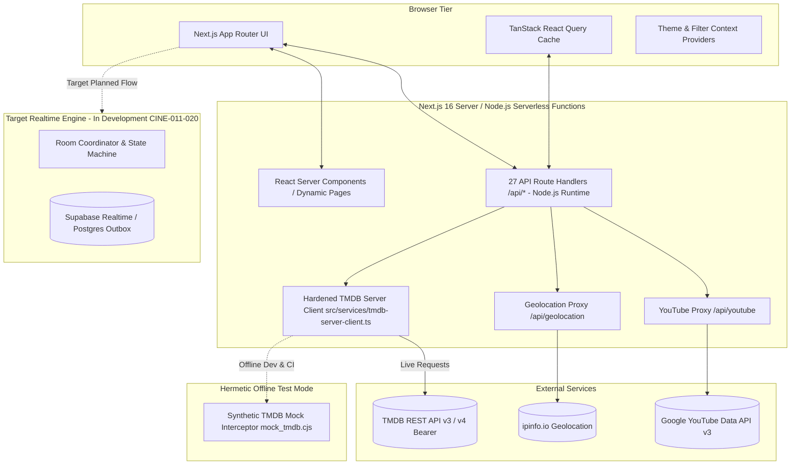

# CineMatch 🎬

> **Real-Time Collaborative Movie Decision Engine**  
> *Transforming the agony of "what should we watch?" into a fast, unanimous group match.*

CineMatch is a modern movie decision and discovery platform built on **Next.js 16.4.5 (Turbopack)**, **Node.js 24 LTS**, **React 19**, and **Tailwind CSS v4**.

The repository is currently organized across two key architectural horizons:
1. **Implemented Foundation (Operational Today):** A high-performance movie & TV discovery catalog featuring 29 UI pages, 27 secure server-side API route handlers on the Node.js runtime, a hardened server-only TMDB client (CINE-006), comprehensive synthetic mock fixtures for offline development, and a strict 5-job automated CI pipeline (CINE-004).
2. **Target Collaborative Engine (Design & Implementation in Progress):** An authoritative server-side room coordinator, anonymous guest session capabilities, frozen rosters, 20-title group decks, confidential binary voting, and unanimous consensus matching, specified in [ADR-002](docs/adr/ADR-002-cinematch-product-contract-and-room-architecture.md) and [ADR-003](docs/adr/ADR-003-realtime-and-persistence-architecture.md) and actively being developed across tasks CINE-011 through CINE-020.

---

## 1. Product Contract & Target MVP Specifications (Planned Architecture)

The upcoming collaborative matching engine is governed by strict functional invariants designed to deliver fast, friction-free decisions without endless browsing:

- **Participant Capacity:** Strictly **2 to 5 participants** per room. Two members is the canonical pair use case; five is the upper bound for unanimous consensus.
- **Anonymous Guest Onboarding:** No login or OAuth friction required. Participants join via 6-character room codes or shareable links and receive cryptographically signed guest session capability tokens.
- **Host Authority & Roster Freeze:** The room creator controls lobby settings. Once the Host starts the voting round, the active participant roster is **frozen**; no mid-round joins or departures alter quorum.
- **Deterministic 20-Title Movie Deck:** Each round serves an identical, server-generated deck of 20 titles tailored to common group preferences.
- **Immutable Secret Voting:** Each participant casts exactly one immutable vote per movie: **LIKE** (accept) or **SKIP** (reject). Individual choices remain confidential until consensus to prevent group bias (CINE-020).
- **Unanimous Match Consensus:** A match is achieved if and only if **100% of the frozen roster** votes `LIKE` on a title. The first unanimous title triggers an instant celebration screen with watch provider details. If all 20 titles are exhausted without unanimous consensus, the room transitions to `NO_MATCH`.
- **Server Authority & Idempotency:** All state transitions and vote tallies are processed server-side with idempotency keys (`roomId:participantId:movieId`). Multi-tenant rooms are strictly isolated.

*Note: ADR-002 and ADR-003 define these target specifications; backend room lifecycle, Supabase Realtime synchronization, and PostgreSQL persistence are actively under development in CINE-011–020.*

---

## 2. System Architecture & Topology



For complete technical specifications, data flows, and route tables, see the [System Architecture & Route Catalog](docs/architecture/system-overview.md).

---

## 3. Technology Stack & Runtime Matrix

| Component | Standardized Technology | Version / Requirement | Notes |
| :--- | :--- | :--- | :--- |
| **Runtime** | Node.js LTS | `24.x` | Pinned in `.nvmrc` and `package.json#engines` |
| **Package Manager**| npm | `>=10.0.0` (11.19.0 verified) | Sole canonical toolchain; `package-lock.json` v3 |
| **Framework** | Next.js | `16.4.5` (Turbopack) | Modernized in CINE-002; full React 19 support |
| **Frontend** | React / React DOM | `19.0.0` | React Server Components & Compiler compatibility |
| **Styling** | Tailwind CSS / PostCSS | `v4.x` | Modern token system with `@tailwindcss/postcss` |
| **UI Primitives** | Radix UI | Latest | Dialog, Popover, Select, Dropdown, Tabs |
| **Command Palette**| cmdk | `^1.1.1` | Native React 19 peer dependency resolution |
| **Date Primitives**| react-day-picker | `^9.14.0` | DayPicker v9 class mappings; zero date-fns peer conflict |
| **Data Fetching** | TanStack React Query | `^5.67.2` | Global QueryClient in `src/app/layout.tsx` |
| **HTTP Client** | Axios | `^1.8.2` | Server-side API client in `src/services/tmdbApi.ts` |
| **Icons** | Lucide React | `^0.479.0` | Accessible SVG icon library |

---

## 4. Developer Onboarding & Quickstart

Follow this deterministic walkthrough from a clean checkout:

### Step 1: Clone Repository and Check Prerequisites
Ensure you are using **Node.js 24 LTS** and **npm 10+**:
```bash
git clone https://github.com/KaisAbiyyi/cinemania.git
cd cinemania

# If using nvm (Node Version Manager):
nvm use
node -v # Should report v24.x
npm -v  # Should report 10.x or 11.x
```

### Step 2: Configure Environment Variables
Copy the documented environment template:
```bash
cp .env.example .env.local
```
*(See [Section 6](#6-environment-variables--omission-behavior) for offline execution if you do not have live TMDB credentials.)*

### Step 3: Install Dependencies (Clean Machine)
Always use `npm ci` for deterministic, clean installs matching `package-lock.json`:
```bash
npm ci
```
*Expected: 432 packages added cleanly with Exit Code 0 and zero peer dependency warnings.*

### Step 4: Run Verification Suite
Verify type safety, linting, and production compilation:
```bash
# 1. Typecheck across all 29 pages and 27 API handlers
npx tsc --noEmit

# 2. Run ESLint checks
npm run lint

# 3. Compile Next.js Turbopack production build
npm run build
```

### Step 5: Start Local Development Server
```bash
npm run dev
```
Open [http://localhost:3000](http://localhost:3000) in your browser.

---

## 5. Offline & Synthetic Developer Fixtures

New developers do **not** need live TMDB credentials or external API network access to run, test, and develop CineMatch features. *(Note: initial `npm ci` dependency installation requires npm registry access or a pre-populated local npm cache; once dependencies are installed, all application data flows, tests, and builds operate completely offline via synthetic mock fixtures.)* The repository includes a deterministic synthetic TMDB interceptor that provides realistic movies, genres, trending feeds, and streaming providers offline:

```bash
# Run Next.js with synthetic TMDB mock interception:
NODE_OPTIONS="--require ./docs/artifacts/cine-002/fixtures/mock_tmdb.cjs" npm run dev

# Or test production build with synthetic fixtures on port 3055:
NODE_OPTIONS="--require ./docs/artifacts/cine-002/fixtures/mock_tmdb.cjs" npx next start -p 3055
```

When active, the interceptor intercepts outbound requests to `api.themoviedb.org`, serving replayable fixtures and recording network telemetry in `docs/artifacts/cine-002/fixtures/request-logs.json`.

---

## 6. Environment Variables & Omission Behavior

The application tracks exactly **5 environment identifiers**. Never commit real API keys to version control.

| Identifier | Scope | Required | Default / Fallback | Omission Behavior & Actionable Error |
| :--- | :---: | :---: | :--- | :--- |
| `TMDB_API_RAT` | Server | Yes (Live) | `undefined` | **Live Mode:** Upstream TMDB returns HTTP 401 Unauthorized (`Authorization: Bearer undefined`).<br>**Offline Mode:** Fully bypassed when running with synthetic mock fixtures. |
| `YOUTUBE_API_KEY` | Server | Optional | `undefined` | Route `/api/youtube` returns HTTP 500: `{"error": "Server configuration error"}` when trailer data is requested without a key. |
| `IPINFO_TOKEN` | Server | Optional | `"YOUR_TOKEN"` | Localhost requests (`127.0.0.1` / `::1`) automatically return `{"region": "US"}` without calling ipinfo.io. |
| `NEXT_PUBLIC_TMDB_POSTER_URL` | Client | Optional | `https://image.tmdb.org/t/p` | Defaults to TMDB CDN (`https://image.tmdb.org/t/p/w500`). Fallback placeholder rendered if missing. |
| `NEXT_PUBLIC_IMAGE_BASE_URL` | Client | Optional | `https://image.tmdb.org/t/p` | Defaults to TMDB CDN for backdrop banners (`DetailBackBanner.tsx`). |

---

## 7. Reconciled Route Catalog Summary

The application provides **29 UI Pages** and **27 API Route Handlers** (total 56 routable endpoints):

- **UI Pages (29 routes):**
  - Discovery & Catalogs: `/`, `/movie`, `/tv`, `/trending`, `/search`
  - Releases & Classifications: `/movie/now-playing`, `/movie/top-rated`, `/movie/upcoming`, `/tv/airing-today`, `/tv/on-tv`, `/tv/top-rated`
  - Dynamic Media & Credits: `/movie/[slug]`, `/tv/[slug]`, `/person/[slug]`, plus `/cast`, `/images`, `/reviews`, `/videos` sub-routes
  - Taxonomies: `/genre/[slug]`, `/genre/[slug]/movie`, `/genre/[slug]/tv`, `/keyword/[slug]`, `/keyword/[slug]/movie`, `/keyword/[slug]/tv`
- **API Handlers (27 routes):**
  - Discovery & Search: `/api/media`, `/api/media/trending`, `/api/genres`, `/api/languages`, `/api/keywords`, `/api/search/*` (keyword, movie, person, tv)
  - Detail Metadata: `/api/media/[id]/*` (credits, images, keywords, recommendations, release_dates, reviews, similar, videos)
  - Person Metadata: `/api/person/[id]/*` (details, combined_credits, images)
  - Integration Proxies: `/api/providers/*` (streaming provider catalogs), `/api/geolocation` (IP region), `/api/youtube` (trailers)

*Refer to [docs/architecture/system-overview.md](docs/architecture/system-overview.md) for the complete path and method table.*

---

## 8. Package Scripts & Verification Matrix

All commands match `package.json` and are verified against clean checkouts:

| Command | Purpose | Verification Standard |
| :--- | :--- | :--- |
| `npm ci` | Clean dependency install | Exit 0; 432 packages deterministically installed |
| `npx tsc --noEmit` | TypeScript typecheck | Exit 0; 0 errors across 56 endpoints |
| `npm run lint` | ESLint flat config audit | Exit 0; 0 errors, 27 triaged compiler warnings |
| `npm run build` | Next.js Turbopack build | Exit 0; compiles and statically prerenders 24 routes |
| `npm run dev` | Local development server | Runs Turbopack on `http://localhost:3000` |
| `npm run start` | Production server | Serves compiled `.next` build |

---

## 9. Architecture Decision Records (ADRs)

Key architectural decisions are documented under `docs/adr/`:

- [ADR-001: Modernization to Next.js 16, Canonical npm Toolchain & Node 24 LTS](docs/adr/ADR-001-modern-stack-and-toolchain.md) — Rationale for Next.js 16.4.5, npm standardization, DayPicker v9, cmdk v1.1.1, and cloud parity.
- [ADR-002: CineMatch Product Contract, Room Architecture & Voting Consensus](docs/adr/ADR-002-cinematch-product-contract-and-room-architecture.md) — 2–5 participant bounds, frozen roster, 20-title deck, unanimous consensus algorithm, and hermetic mock fixtures.
- [Package Manager & CI Cache Guidance](docs/caching-and-package-manager.md) — GitHub Actions caching strategies and Vercel build container specifications.
- [CINE-001 Baseline Regression Audit](docs/audits/CINE-001-baseline-report.md) — Historical baseline defect analysis and inventory reconciliation.

---

## 10. Foundation History & Release Milestones

- **CINE-001 (Baseline Audit & Defect Snapshot):** Documented clean install defects, reconciled inventory (29 pages, 27 API routes, 5 env variables), and established non-negotiable governance fences ([PR #33](https://github.com/KaisAbiyyi/cinemania/pull/33)).
- **CINE-002 (Next.js 16.4.5 Modernization):** Upgraded Next.js to 16.4.5, mitigated React Server Components CVEs, resolved React 19 peer dependencies, and established visual/HTTP evidence baseline ([PR #35](https://github.com/KaisAbiyyi/cinemania/pull/35), [PR #36](https://github.com/KaisAbiyyi/cinemania/pull/36)).
- **CINE-003 (Canonical Toolchain & Reproducibility):** Standardized on `npm`, eliminated `bun.lock`, pinned Node 24 LTS, committed `vercel.json` for cloud build parity, and documented CI caching ([PR #34](https://github.com/KaisAbiyyi/cinemania/pull/34)).
- **CINE-005 (README, ADRs & Developer Onboarding):** Replaced starter documentation with comprehensive architecture, setup guide, route catalogs, `.env.example`, ADR-001/002, and offline synthetic fixture workflows ([PR #37](https://github.com/KaisAbiyyi/cinemania/pull/37)).

---

## 11. Governance & Agent Execution Contract

All development in this repository is strictly governed by the [CineMatch Agent Execution Contract](AGENTS.md):

- **No Unverified Claims:** An agent's confident statement is never evidence. Concrete command outputs, exit codes, git SHAs, and linked artifacts are mandatory.
- **Durable Evidence Receipts:** Every task must publish a formal `Evidence Receipt` and `Implementation Summary` citing exact pinned commit SHAs.
- **Zero Secret Leakage:** Never commit secrets, tokens, cookies, or real `.env` files.
- **Strict Scope Boundaries:** Tasks only modify files within their declared resource lock scope. Product decisions outside the task issue contract are forbidden.
