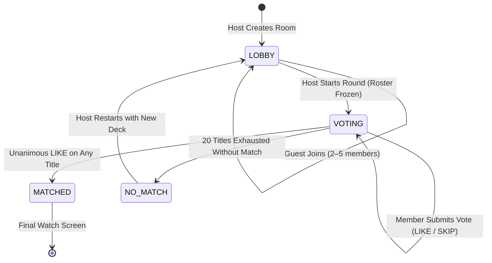

# ADR-002: CineMatch Product Contract, Room Architecture & Voting Consensus

- **Status:** Accepted
- **Deciders:** CineMatch Architecture Team & Repository Owner
- **Date:** 2026-11-05 (Reified 2026-11-08)
- **Task References:** [CINE-011](https://github.com/KaisAbiyyi/cinemania/issues/13), [CINE-012](https://github.com/KaisAbiyyi/cinemania/issues/14), [CINE-017](https://github.com/KaisAbiyyi/cinemania/issues/19), [CINE-018](https://github.com/KaisAbiyyi/cinemania/issues/20), [CINE-019](https://github.com/KaisAbiyyi/cinemania/issues/21)

---

## 1. Context and Problem Statement

The CineMania project originated as a single-user TMDB movie catalog explorer. The strategic mission of CineMatch is to transform this platform into a **real-time, collaborative movie decision engine** for small groups (friends, partners, or households) deciding what to watch together without endless scrolling or decision fatigue.

To achieve a reliable, low-friction experience, the core matching engine requires clear architectural boundaries, authoritative state transitions, and deterministic consensus rules.

---

## 2. Product Contract & Architecture Principles

### 2.1 Room Capacity & Participant Bounds
- **Participant Range:** Exactly **2 to 5 participants** per room.
- **Rationale:** Two participants is the canonical use case (couples/roommates); five represents the practical ceiling for synchronous voting consensus before unanimous agreement probability approaches zero.
- **Anonymous Guest Onboarding:** No mandatory registration or OAuth login required. Users enter a display name and receive a cryptographically signed guest session capability token.

### 2.2 Roster Freeze & Host Authority
- **Lobby Phase:** The room creator is designated the Host. Participants join via 6-character room codes or shareable invite links.
- **Roster Freeze:** When the Host initiates the voting round, the active participant roster is **frozen**. No new participants may join mid-round, and departing participants cannot alter quorum requirements.
- **Server Authority:** All room state transitions (LOBBY → VOTING → MATCHED / NO_MATCH) are executed exclusively by server-authoritative route handlers or realtime coordinators. Clients emit vote intents; the server records canonical state.

### 2.3 Deterministic Movie Deck
- **Deck Size:** Fixed at **20 titles** per round.
- **Content Generation:** Generated server-side using TMDB discovery APIs filtered by common genre/provider preferences selected in the lobby.
- **Deck Ordering:** Deterministic ordering across all participants in the room to ensure synchronized card stacks.

### 2.4 Immutable Voting & Unanimous Consensus
- **Vote Actions:** Binary vote per title: `LIKE` (swipe right / accept) or `SKIP` (swipe left / reject).
- **Immutability:** Once submitted for a movie in a round, a participant's vote cannot be modified or withdrawn.
- **Consensus Rule:** Unanimous match only. A title is declared a Match if and only if **100% of the frozen roster members** submit a `LIKE` vote for that title.
- **Early Match Termination:** The moment a title achieves unanimous `LIKE` consensus, the round completes immediately, transitioning the room to `MATCHED` state and rendering the celebration/watch details screen.
- **No-Match Termination:** If all 20 titles are exhausted without achieving unanimous consensus, the room transitions to `NO_MATCH`, offering the host options to restart with expanded filters.

### 2.5 Resilient Reconnection & Idempotency
- **Idempotent Vote Processing:** Votes carry idempotency keys (`roomId:participantId:movieId`). Duplicate network submissions return the recorded state without error.
- **Session Recovery:** Reconnecting clients supply their guest token and resume voting at their current deck offset without losing previously recorded votes.
- **Isolation:** Multi-tenant rooms are strictly isolated. No room event, member list, or vote state may leak to another room.

### 2.6 Offline & Synthetic Provider Fixtures
- **Hermetic Testing:** Local developer onboarding and continuous integration must not depend on live TMDB network access or live tokens.
- **Synthetic Interceptor:** Development and CI utilize replayable fixture interception (`docs/artifacts/cine-002/fixtures/mock_tmdb.cjs`), providing rich synthetic movies, genres, and streaming providers offline.

---

## 3. Room State Machine

---

## 4. Consequences

### Positive
- Predictable and fast decision outcomes; eliminates voting gridlock.
- Strong server guarantees prevent client cheating or desynchronization.
- Zero credential exposure: TMDB Read Access Tokens remain strictly within server-side runtimes.
- Fully testable in air-gapped or offline development environments via synthetic mock fixtures.

### Negative / Tradeoffs
- Unanimous consensus becomes harder with larger groups (hence the strict 5-participant cap).
- Roster freeze requires disconnected users to reconnect within a timeout window rather than allowing arbitrary mid-round substitutions.
