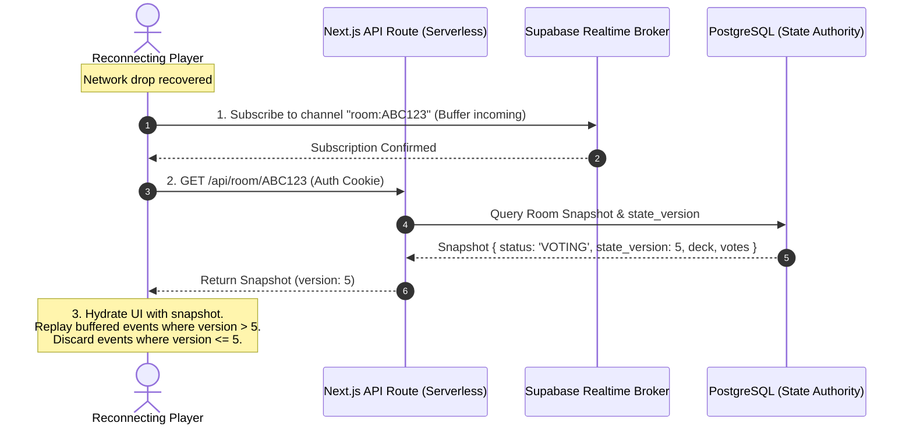

# ADR-003: Realtime and Persistence Architecture for CineMatch Rooms

- **Status:** Proposed (Under Review)
- **Deciders:** CineMatch Architecture Team (Owner Approval Pending)
- **Date:** 2026-11-09 (Revised 2026-11-09)
- **Task References:** [CINE-011](https://github.com/KaisAbiyyi/cinemania/issues/13), [CINE-012](https://github.com/KaisAbiyyi/cinemania/issues/14), [CINE-013](https://github.com/KaisAbiyyi/cinemania/issues/15), [CINE-014](https://github.com/KaisAbiyyi/cinemania/issues/16), [CINE-017](https://github.com/KaisAbiyyi/cinemania/issues/19), [CINE-018](https://github.com/KaisAbiyyi/cinemania/issues/20), [CINE-019](https://github.com/KaisAbiyyi/cinemania/issues/21)
- **Predecessor Dependencies:** [CINE-001 (Audit)](https://github.com/KaisAbiyyi/cinemania/issues/3), [CINE-004 (CI)](https://github.com/KaisAbiyyi/cinemania/issues/6), [ADR-002 (Product Contract)](https://github.com/KaisAbiyyi/cinemania/pull/37)

---

## 1. Context and Problem Statement

CineMatch is a collaborative movie matching decision platform for small groups (2 to 5 participants) running on Next.js 16 (App Router) deployed to Vercel/serverless cloud infrastructure.

In serverless execution environments, compute functions are **stateless, ephemeral, and horizontally scaled across independent worker processes**. Two or more room participants submitting votes or awaiting room events will almost certainly connect to different serverless instances. Consequently:
1. **Absence of Native Long-Lived Sockets:** Serverless runtimes cannot hold persistent in-memory room state or terminate bi-directional stateful WebSockets directly without incurring connection termination, state fragmentation, or prohibitive function execution duration billing.
2. **Atomic Voting Consensus & Phantom Reads:** Votes are immutable and require unanimous agreement across the frozen roster. Concurrent votes submitted by multiple participants at the same millisecond under standard Read Committed isolation can lead to phantom reads: if Transaction 1 and Transaction 2 both count votes before either commits, both can observe incomplete totals and fail to transition the room to `MATCHED`.
3. **Session Reconnection & Event Gaps:** Participants on mobile devices experience transient network drops, lock-screen suspension, and browser reloads. Subscribing to an ephemeral broadcast channel after fetching a snapshot introduces a race window where events occurring between the snapshot read and WebSocket subscription establishment are lost.
4. **Security & Zero Leaks:** Database connection strings, service credentials, and TMDB tokens must never leak to the client browser. Client access must be restricted to signed guest capability tokens and scoped, authorized channel subscriptions.

---

## 2. Decision Drivers

- **Serverless & Multi-Instance Compatibility:** Architecture must operate natively on multi-instance serverless deployments without requiring self-hosted stateful server processes.
- **Strict State Authority & Concurrency Control:** State mutations (roster freeze, vote recording, unanimous match transitions) must be atomic and server-authoritative, serialized by database row-level locking (`SELECT ... FOR UPDATE`) and guarded transitions.
- **Low-Latency Event Fan-out:** Room event propagation (lobby joins, votes cast, match found) should reach room participants in <100ms under normal cloud network conditions.
- **Cost & Free Tier Limits:** Must provide a sustainable free tier for development/MVP and predictable scale-to-zero cost.
- **Resilient Reconnection:** Version/sequence-based event ordering and transactional outbox persistence to prevent event gap races.

---

## 3. Comparative Architecture Analysis

| Evaluation Dimension | Candidate A: Managed Postgres + Realtime (Supabase Proposal) | Candidate B: Serverless Postgres (Neon) + SSE / Polling | Candidate C: Stateful Edge WebSockets (PartyKit / Durable Objects) | Candidate D: Redis Pub/Sub (Upstash) + SSE |
| :--- | :--- | :--- | :--- | :--- |
| **Persistence Engine** | Managed PostgreSQL (ACID, relational schema, JSONB, row-level locks) | Serverless PostgreSQL (Neon branching, ACID) | Ephemeral in-memory actor state + SQLite/Blob persistence | Key-value / Hashes (in-memory Redis data structures) |
| **Realtime Event Transport** | Managed WebSockets (Realtime Broadcast & WAL replication) | Server-Sent Events (SSE) or short HTTP polling | Stateful bi-directional WebSockets terminating on edge actor | SSE or long polling via serverless functions |
| **Vercel / Serverless Parity** | **High compatibility.** Clients connect directly to managed Realtime endpoint; serverless functions mutate DB over connection pooler. | **Limited.** Vercel function duration limits (15s–300s) make long-lived SSE connections fragile and costly. | **External.** Requires deploying and managing separate edge infrastructure outside Vercel. | **Moderate.** Requires pub/sub polling or external SSE worker. |
| **Multi-Instance Handling** | **Decoupled.** Serverless instances mutate PostgreSQL atomically; Supabase Realtime fans out events globally. | **Complex.** Multi-instance SSE requires separate Redis pub/sub backplane to synchronize instances. | **Single-actor.** Each room pinned to single edge actor; multi-region latency variations. | **Good.** Upstash Pub/Sub relays messages across instances. |
| **Concurrency & Atomic Consensus** | **Highest.** Native `SELECT ... FOR UPDATE` row locks and atomic guarded SQL transactions. | **Highest.** Native PostgreSQL ACID transactions. | **High.** Single-threaded JavaScript event loop per room actor. | **Moderate.** Requires complex Redis Lua scripts for multi-key consistency. |
| **Cost & Free Tier Limits** | 500 MB DB, 200 concurrent Realtime connections, 50k MAU free. Sufficient for MVP. | Neon 0.5 GB free + Vercel execution duration billing for SSE streams. | Separate PartyKit / Cloudflare subscription required. | Pay-per-command; aggressive polling quickly drives command costs. |
| **Client Bundle Security** | Public anon key + RLS + server-authoritative API routes. Zero database secrets in browser. | Server routes only; zero secrets in client. | Client connects with room token; zero secrets in client. | Redis credentials held server-side; zero secrets in client. |

---

## 4. Proposed Architecture Specification

We propose **Candidate A: Managed PostgreSQL with Realtime Event Transport (Supabase Architecture)** as the baseline persistence and real-time backend architecture for CineMatch:

### 4.1 Strict State Authority & Transactional Concurrency Control
Canonical room state, rosters, movie decks, and votes reside in PostgreSQL tables (`rooms`, `room_participants`, `room_deck`, `votes`, `room_events`).

To eliminate race conditions, phantom reads, and double-matching under parallel writes across multiple serverless instances:
1. **Per-Room Row Locking:** Every vote mutation transaction begins by acquiring an exclusive row-level lock on the room:
   ```sql
   -- Acquire exclusive lock for this room; serializes concurrent votes
   SELECT id, status, participant_count, state_version 
   FROM rooms 
   WHERE id = $1 AND status = 'VOTING' 
   FOR UPDATE;
   ```
2. **Membership & Invariant Validation:**
   - Verify room status is `VOTING`.
   - Verify `participant_id` exists in the frozen roster.
   - Verify `movie_id` exists in the room deck.
3. **Idempotent Vote Recording:**
   - Enforce single immutable vote per participant/title:
     ```sql
     INSERT INTO votes (room_id, participant_id, movie_id, vote, created_at)
     VALUES ($1, $2, $3, $4, NOW())
     ON CONFLICT (room_id, participant_id, movie_id) DO NOTHING;
     ```
4. **Guarded State Transition & Consensus Evaluation:**
   - Count distinct `LIKE` votes for this movie:
     ```sql
     SELECT COUNT(DISTINCT participant_id) 
     FROM votes 
     WHERE room_id = $1 AND movie_id = $2 AND vote = 'LIKE';
     ```
   - If count equals the frozen `participant_count`, execute a guarded transition:
     ```sql
     UPDATE rooms 
     SET status = 'MATCHED', 
         matched_movie_id = $2, 
         state_version = state_version + 1,
         updated_at = NOW()
     WHERE id = $1 AND status = 'VOTING'
     RETURNING *;
     ```
   - Because of the row-level lock and the `WHERE status = 'VOTING'` guard, exactly one transaction can transition the room to `MATCHED`. Subsequent or concurrent transactions for that room read the locked, committed state and return the match immediately.

5. **Transactional Outbox for Guaranteed Event Reliability:**
   - Within the *same* database transaction, insert an event into `room_events`:
     ```sql
     INSERT INTO room_events (room_id, version, event_type, payload, created_at)
     VALUES ($1, $new_version, $event_type, $payload, NOW());
     ```
   - This ensures events are strictly ordered by monotonic `version` and committed atomically with state changes.

### 4.2 Room Access Isolation & Channel Authorization
1. **Signed Realtime Capability Token:**
   - When a guest joins or re-authenticates, the server issues a signed, short-lived JWT scoped strictly to that room:
     `{ sub: participantId, room_id: roomId, role: 'authenticated', exp: <timestamp> }`.
2. **Channel Authorization & Row-Level Security:**
   - Realtime channel is private: `room:${room_code}`.
   - Subscriptions require the capability JWT. Supabase Realtime verifies the JWT and enforces Row-Level Security:
     ```sql
     CREATE POLICY "Room participants only" 
     ON realtime.messages 
     FOR SELECT 
     USING (room_id = (auth.jwt() ->> 'room_id'));
     ```
   - Non-members attempting to listen to an unauthorized room channel are rejected with `403 Forbidden`.

### 4.3 Subscribe-First & Version-Reconciled Reconnect Protocol
To prevent the reconnect race condition (where events are lost between snapshot retrieval and socket connection):
1. **Subscribe First:** The reconnecting client establishes its WebSocket connection and subscribes to `room:${room_code}`, buffering incoming real-time events locally.
2. **Fetch Snapshot:** The client requests the authoritative snapshot via HTTP `GET /api/room/[code]`, which returns the current room state along with its `state_version`.
3. **Reconcile Buffer:**
   - The client hydrates UI state from the snapshot.
   - The client filters buffered events: any event with `version <= snapshot.state_version` is discarded as already incorporated.
   - Any event with `version > snapshot.state_version` is applied in sequential order.
   - If an event version gap is detected (e.g. buffered events skip from version 5 to 7), the client triggers an immediate catch-up query:
     `GET /api/room/[code]/events?since=${snapshot.state_version}`.



---

## 5. Consequences & Tradeoffs

### Positive
- **Serverless Alignment:** Next.js API routes scale to zero on Vercel; compute does not hold stateful socket connections in memory.
- **Concurrency Safety:** Explicit PostgreSQL `SELECT ... FOR UPDATE` row locks guarantee serialization of concurrent votes across distinct serverless instances, eliminating double-matches and phantom reads.
- **Durability & Catch-Up:** Monotonic `state_version` and transactional outbox eliminate the snapshot-then-subscribe race window.
- **Tenant Isolation:** Private channels authorized via signed room-scoped JWTs ensure zero cross-room event leakage.

### Negative / Tradeoffs
- External managed service dependency (Supabase / PostgreSQL connection pooler).
- Free tier limit of 200 concurrent Realtime connections provides capacity for ~40 simultaneous 5-player rooms during MVP. Growth beyond this threshold requires upgrading to paid usage tiers.

---

## 6. Implementation & Verification Roadmap
- **CINE-012:** Authoritative PostgreSQL schema (`rooms`, `room_participants`, `room_deck`, `votes`, `room_events`), migrations, and row-level locking stored procedure.
- **CINE-013:** Anonymous guest identity, cryptographically signed capability tokens, and cookie handling.
- **CINE-014:** Room creation, 6-character room code generation, and capacity enforcement.
- **CINE-018:** Realtime event publication, private channel authorization, and outbox subscriber.
