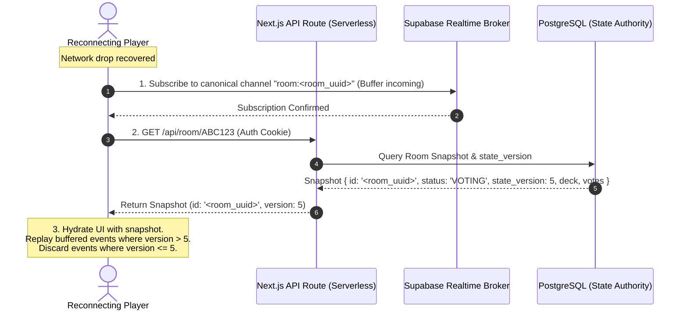

# ADR-003: Realtime and Persistence Architecture for CineMatch Rooms

- **Status:** Proposed (Under Review)
- **Deciders:** CineMatch Architecture Team (Owner Approval Pending)
- **Date:** 2026-11-09 (Revised 2026-11-10)
- **Task References:** [CINE-011](https://github.com/KaisAbiyyi/cinemania/issues/13), [CINE-012](https://github.com/KaisAbiyyi/cinemania/issues/14), [CINE-013](https://github.com/KaisAbiyyi/cinemania/issues/15), [CINE-014](https://github.com/KaisAbiyyi/cinemania/issues/16), [CINE-017](https://github.com/KaisAbiyyi/cinemania/issues/19), [CINE-018](https://github.com/KaisAbiyyi/cinemania/issues/20), [CINE-019](https://github.com/KaisAbiyyi/cinemania/issues/21)
- **Predecessor Dependencies:** [CINE-001 (Audit)](https://github.com/KaisAbiyyi/cinemania/issues/3), [CINE-004 (CI)](https://github.com/KaisAbiyyi/cinemania/issues/6), [ADR-002 (Product Contract)](https://github.com/KaisAbiyyi/cinemania/pull/37)

---

## 1. Context and Problem Statement

CineMatch is a collaborative movie matching decision platform for small groups (2 to 5 participants) running on Next.js 16 (App Router) deployed to Vercel/serverless cloud infrastructure.

In serverless execution environments, compute functions are **stateless, ephemeral, and horizontally scaled across independent worker processes**. Two or more room participants submitting votes or awaiting room events will almost certainly connect to different serverless instances. Consequently:
1. **Absence of Native Long-Lived Sockets:** Serverless runtimes cannot hold persistent in-memory room state or terminate bi-directional stateful WebSockets directly without incurring connection termination, state fragmentation, or prohibitive function execution duration billing.
2. **Atomic Voting Consensus & Phantom Reads:** Votes are immutable and require unanimous agreement across the frozen roster. Concurrent votes submitted by multiple participants at the same millisecond under standard Read Committed isolation can lead to phantom reads: if Transaction 1 and Transaction 2 both count votes before either commits, both can observe incomplete totals and fail to transition the room to `MATCHED`.
3. **Session Reconnection & Event Gaps:** Participants on mobile devices experience transient network drops, lock-screen suspension, and browser reloads. Subscribing to an ephemeral broadcast channel after fetching a snapshot introduces a race window where events occurring between the snapshot read and WebSocket subscription establishment are lost.
4. **Security & Zero Leaks:** Database connection strings, service credentials, and TMDB tokens must never leak to the client browser. Client access must be restricted to signed guest capability tokens and scoped, authorized channel subscriptions.

---

## 2. Decision Drivers

- **Serverless & Multi-Instance Compatibility:** Architecture must operate natively on multi-instance serverless deployments without requiring self-hosted stateful server processes.
- **Strict State Authority & Concurrency Control:** State mutations (roster freeze, vote recording, unanimous match transitions) must be atomic and server-authoritative, serialized by database row-level locking (`SELECT ... FOR UPDATE`) and guarded transitions.
- **Low-Latency Event Fan-out:** Room event propagation (lobby joins, votes cast, match found) should reach room participants in <100ms under normal cloud network conditions.
- **Cost & Free Tier Limits:** Must provide a sustainable free tier for development/MVP and predictable scale-to-zero cost.
- **Resilient Reconnection:** Version/sequence-based event ordering and transactional outbox persistence to prevent event gap races.

---

## 3. Comparative Architecture Analysis

| Evaluation Dimension | Candidate A: Managed Postgres + Realtime (Supabase Proposal) | Candidate B: Serverless Postgres (Neon) + SSE / Polling | Candidate C: Stateful Edge WebSockets (PartyKit / Durable Objects) | Candidate D: Redis Pub/Sub (Upstash) + SSE |
| :--- | :--- | :--- | :--- | :--- |
| **Persistence Engine** | Managed PostgreSQL (ACID, relational schema, JSONB, row-level locks) | Serverless PostgreSQL (Neon branching, ACID) | Ephemeral in-memory actor state + SQLite/Blob persistence | Key-value / Hashes (in-memory Redis data structures) |
| **Realtime Event Transport** | Managed WebSockets (Realtime Broadcast & WAL replication) | Server-Sent Events (SSE) or short HTTP polling | Stateful bi-directional WebSockets terminating on edge actor | SSE or long polling via serverless functions |
| **Vercel / Serverless Parity** | **High compatibility.** Clients connect directly to managed Realtime endpoint; serverless functions mutate DB over connection pooler. | **Limited.** Vercel function duration limits (15s–300s) make long-lived SSE connections fragile and costly. | **External.** Requires deploying and managing separate edge infrastructure outside Vercel. | **Moderate.** Requires maintaining connection pools or HTTP polling proxies. |
| **State Authority & Concurrency** | **Strict.** PostgreSQL row-level locks (`SELECT ... FOR UPDATE`) and guarded `UPDATE rooms SET status = 'MATCHED'`. | **Strict.** Full PostgreSQL transaction isolation. | **Actor-isolated.** Single-threaded execution per room actor prevents internal race conditions. | **Conditional.** Redis Lua scripts provide atomic script execution, but lack relational constraints. |
| **Reconnection & Catch-Up** | Monotonic `state_version` + Transactional Outbox table (`room_events`) queryable via REST. | Snapshot query + SSE `Last-Event-ID` or manual polling. | Client re-attaches to durable actor; in-memory replay buffer. | Redis Stream `XREAD` with offset tracking. |
| **Cost & Free Tier Limits** | 500 MB DB, 200 concurrent Realtime connections, 2M Realtime messages/mo. | Generous storage and compute hours; no built-in WebSocket broker. | Free tier for hobby; per-request / per-room actor charges at scale. | 10k commands/day free; $0.20 per 100k commands thereafter. |

---

## 4. Decision Outcome

**Proposed Architecture:** **Candidate A — Managed PostgreSQL with Supabase Realtime Engine**.

### 4.1 State Machine Authority & Concurrency Model
1. **Server as Single Authority:** Client UI components are purely reactive projections. The server holds exclusive authority over:
   - Room lifecycle: `LOBBY -> VOTING -> MATCHED | NO_MATCH`.
   - Deck assignment: Exactly 20 movies frozen at round start.
   - Vote immutability: Exactly 1 vote per member per movie.
   - Matching rule: Unanimous consensus across all members in the frozen roster.

2. **Row-Level Locking Concurrency Control:**
   When concurrent swiping occurs, incoming votes execute within a PostgreSQL transaction with an explicit row lock:
   ```sql
   -- Acquire exclusive row lock on the room row to serialize concurrent vote processing
   SELECT id, status, participant_count, state_version 
   FROM rooms 
   WHERE id = $1 
   FOR UPDATE;
   ```
3. **Guarded State Transition:**
   - Votes are recorded in `votes` table (`ON CONFLICT (room_id, participant_id, movie_id) DO NOTHING`).
   - If vote is `LIKE`, count total `LIKE` votes for this `movieId` in the locked room:
     ```sql
     SELECT COUNT(*) FROM votes WHERE room_id = $1 AND movie_id = $2 AND vote = 'LIKE';
     ```
   - If `COUNT(*) == participant_count`, execute guarded transition:
     ```sql
     UPDATE rooms 
     SET status = 'MATCHED', 
         matched_movie_id = $2, 
         state_version = state_version + 1,
         updated_at = NOW()
     WHERE id = $1 AND status = 'VOTING'
     RETURNING *;
     ```
   - Exactly one concurrent transaction succeeds in transitioning the status; other concurrent transactions read the committed `MATCHED` status and return the match immediately without duplicate transitions.

4. **Transactional Outbox for Event Ordering:**
   - In the same database transaction, insert an event into `room_events`:
     ```sql
     INSERT INTO room_events (room_id, version, event_type, payload, created_at)
     VALUES ($1, $new_version, $event_type, $payload, NOW());
     ```
   - Events have strictly ordered, monotonic `version` integers.

### 4.2 Room Access Isolation & Channel Authorization
1. **Cryptographically Signed Realtime Capability Token:**
   - When a guest joins or re-authenticates, the server issues a signed, short-lived HMAC-SHA256 JWT scoped strictly to that room:
     `{ sub: participant_id, room_id: room_id, role: 'authenticated', iat: <seconds>, exp: <seconds> }`.
   - Token timestamps conform strictly to RFC 7519 `NumericDate` (integer seconds since Unix epoch).
2. **Channel Authorization & Row-Level Security (Supabase Realtime Private Channels):**
   - **Canonical Topic Standard:** Realtime channel topic is strictly and exclusively formatted as `room:${room_id}` where `room_id` is the opaque room UUIDv4 (never the user-facing 6-character room code).
   - Channel connections require the capability JWT. Supabase Realtime Authorization evaluates Row-Level Security policies on `realtime.messages` using `realtime.topic()`:
     ```sql
     -- 1. Authorize private channel subscription (listen)
     CREATE POLICY "Authorize room channel subscription"
     ON realtime.messages
     FOR SELECT
     TO authenticated
     USING (
       -- Compare channel topic to authorized room ID claim in JWT
       realtime.topic() = ('room:' || (auth.jwt() ->> 'room_id'))
       -- Authorize only registered participants in the room roster (CINE-013 guest participant_id)
       AND EXISTS (
         SELECT 1 FROM public.room_participants
         WHERE room_id = (auth.jwt() ->> 'room_id')::uuid
           AND participant_id = (auth.jwt() ->> 'sub')::uuid
       )
     );

     -- 2. Authorize private channel publication (broadcast)
     CREATE POLICY "Authorize room broadcast publication"
     ON realtime.messages
     FOR INSERT
     TO authenticated
     WITH CHECK (
       realtime.topic() = ('room:' || (auth.jwt() ->> 'room_id'))
       AND EXISTS (
         SELECT 1 FROM public.room_participants
         WHERE room_id = (auth.jwt() ->> 'room_id')::uuid
           AND participant_id = (auth.jwt() ->> 'sub')::uuid
       )
     );
     ```
   - **Permission Grants & Service Key Lifecycle:** The PostgreSQL `authenticated` role requires `SELECT` permissions on `public.room_participants` (or via a SECURITY DEFINER authorization function). The Supabase service-role secret is strictly server-only and never exposed to client browsers or mobile devices.
   - Non-members, expired tokens, tampered signatures, or attempts to subscribe to another room's channel topic or subscribe using the room code (e.g. `room:ABC123`) are rejected with `403 Forbidden`.

### 4.2.1 Anonymous Guest Identity & RLS Reconciliation (CINE-013 & CINE-018)
In CineMatch, users participate as anonymous guests without registering email/password accounts or having rows in Supabase Auth's `auth.users` table:
1. **Guest Identity Generation:** The server generates a cryptographic UUIDv4 `participant_id` for each guest, sealed in an `HttpOnly, Secure, SameSite=Lax` cookie (`cinematch_guest_token`).
2. **Room Membership Table:** When a guest joins a room, a row is persisted in `public.room_participants (room_id, participant_id, role, joined_at)`.
3. **Realtime Capability JWT Claims (RFC 7519 Compliant):** To connect to Supabase Realtime private channels, the server issues a scoped JWT signed with the project's Supabase JWT secret using algorithm `HS256`:
   ```json
   {
     "sub": "<participant_id_uuid>",
     "room_id": "<room_id_uuid>",
     "role": "authenticated",
     "iat": 1700000000,
     "exp": 1700003600
   }
   ```
   Note: `iat` and `exp` are integer seconds (RFC 7519 `NumericDate`), strictly bounded and validated.
4. **Channel Authorization Enforcement:** Supabase Realtime Authorization evaluates `realtime.topic()` against `room:${room_id}` and executes the RLS subquery against `public.room_participants` matching `participant_id = (auth.jwt() ->> 'sub')::uuid`. Non-members cannot subscribe or publish to the room's channel.
5. **Outstanding Live Cloud Qualification Gate:** While this policy and token contract are simulated and validated locally in `tests/integration/realtime-persistence-poc.test.ts`, live configuration and end-to-end testing against a real Supabase project (private channels extension, live RLS evaluation, WebSocket token handshake) remain **BLOCKED and OUTSTANDING** until Supabase infrastructure is provisioned in CINE-012/CINE-018.

### 4.3 Subscribe-First & Version-Reconciled Reconnect Protocol
To prevent the reconnect race condition (where events are lost between snapshot retrieval and socket connection):
1. **Subscribe First:** The reconnecting client establishes its WebSocket connection and subscribes to the canonical private channel topic `room:${room_id}` (where `room_id` is the opaque UUID obtained from session state or prior join, never the shareable 6-character room code), buffering incoming real-time events locally.
2. **Fetch Snapshot:** The client requests the authoritative snapshot via HTTP `GET /api/room/[code]`, which returns the current room state along with its `id` (the opaque UUID) and `state_version`.
3. **Reconcile Buffer:**
   - The client hydrates UI state from the snapshot.
   - The client filters buffered events: any event with `version <= snapshot.state_version` is discarded as already incorporated.
   - Any event with `version > snapshot.state_version` is applied in sequential order.
   - If an event version gap is detected (e.g. buffered events skip from version 5 to 7), the client triggers an immediate catch-up query:
     `GET /api/room/[code]/events?since=${snapshot.state_version}`.



---

## 5. Consequences & Tradeoffs

### Positive
- **Serverless Alignment:** Next.js API routes scale to zero on Vercel; compute does not hold stateful socket connections in memory.
- **Concurrency Safety:** Explicit PostgreSQL `SELECT ... FOR UPDATE` row locks guarantee serialization of concurrent votes across distinct serverless instances, eliminating double-matches and phantom reads.
- **Durability & Catch-Up:** Monotonic `state_version` and transactional outbox eliminate the snapshot-then-subscribe race window.
- **Tenant Isolation:** Private channels authorized via signed room-scoped JWTs ensure zero cross-room event leakage.

### Negative / Tradeoffs
- External managed service dependency (Supabase / PostgreSQL connection pooler).
- Free tier limit of 200 concurrent Realtime connections provides capacity for ~40 simultaneous 5-player rooms during MVP. Growth beyond this threshold requires upgrading to paid usage tiers.

### Concurrency Verification Scope & Cloud Deployment Caveat
- **Relational Concurrency Model vs Production Cloud Behavior:** The local POC in `tests/integration/realtime-persistence-poc.test.ts` validates relational ACID transaction serialization, exclusive transaction locking (`BEGIN IMMEDIATE`), and single guarded transitions across isolated worker threads with deterministic write contention and lock waiting. However, SQLite file locking differs from PostgreSQL row-level locks (`SELECT ... FOR UPDATE`), and worker threads do not simulate multi-process serverless network latency, connection pooling (PgBouncer), or failover.
- Therefore, the relational model serves as algorithmic and architectural proof of concept; full multi-instance PostgreSQL row-level locking and Supabase Realtime verification remain **OUTSTANDING** and must be qualified on live cloud infrastructure during CINE-012 (PostgreSQL schema & migrations) and CINE-018 (Realtime broadcaster).

---

## 6. Implementation Roadmap
- **CINE-012:** Authoritative PostgreSQL schema (`rooms`, `room_participants`, `room_deck`, `votes`, `room_events`), migrations, and row-level locking stored procedure.
- **CINE-013:** Anonymous guest identity, cryptographically signed capability tokens, and cookie handling.
- **CINE-014:** Room creation, 6-character room code generation, and capacity enforcement.
- **CINE-018:** Realtime event publication, private channel authorization, and outbox subscriber.

---

## 7. Verification & Acceptance Status

- **Cryptographic Capability Token Signing & Tamper Verification:** Verified in `tests/integration/realtime-persistence-poc.test.ts` (RFC 7519 NumericDate seconds, HMAC-SHA256, timingSafeEqual, expiration, roster membership, alg header validation).
- **Channel Access Isolation & Topic Authorization:** Verified via local topic and roster simulation (model only).
- **Relational Multi-Worker Concurrency & ACID Isolation:** Verified via Node 24 `node:sqlite` WAL mode across two isolated worker threads with deterministic write contention and lock waiting (SQLite algorithmic model only).
- **Subscribe-First Reconnect & Exact Monotonic Outbox Replay:** Verified with deterministic version recovery `[4, 5, 6]` (model only).
- **Local Latency Percentiles:** Verified in local asynchronous mock (model only, not deployed cloud latency).
- **External Multi-Instance PostgreSQL & Live Supabase Cloud Infrastructure:** Explicitly marked **OUTSTANDING & BLOCKED** pending cloud infrastructure provisioning in CINE-012/CINE-018.
