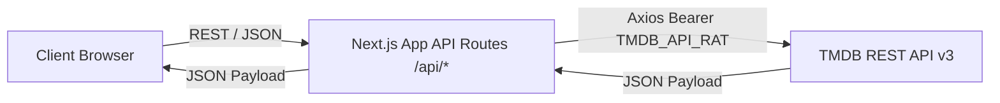

# CINE-001 · Baseline Source & Regression Audit Report

- **Task ID:** CINE-001
- **Task Title:** Snapshot existing code and regression baseline
- **Canonical Issue:** [GitHub Issue #3](https://github.com/KaisAbiyyi/cinemania/issues/3)
- **Repository:** `KaisAbiyyi/cinemania`
- **Audited Commit SHA (Pinned):** `a7b93e9b44d56ea50bb877ef47660e8bb021d358`
- **Auditor / Implementor:** Antigravity (Gemini 3.8 Flash)
- **Governance Precedence:** [Strict Agent Execution Governance](https://app.notion.com/p/40fc4a6aaf7381169c17ee5584d48fef) & [PR #32 AGENTS.md](https://github.com/KaisAbiyyi/cinemania/pull/32) (`29ae9369111610088558504245da6ab32e1b3d20`)
- **Execution Mode:** Read-only audit on product code; docs-only evidence artifact PR.

---

## 1. Executive Summary & Core Verdict

A complete read-only audit of `KaisAbiyyi/cinemania` was executed against the pinned baseline commit `a7b93e9b44d56ea50bb877ef47660e8bb021d358`.

### Core Findings
1. **Clean Dependency Installation is BROKEN (Existing Product Defect):**
   - Clean reproducible install via `npm ci` fails deterministically (**Exit Code 1**, `ERESOLVE unable to resolve dependency tree`).
   - Root cause: `cmdk@1.0.0` specifies peer dependency `react@"^18.0.0"`, but the project root specifies `react@"^19.0.0"` (resolved `19.3.1`).
   - Lockfile desynchronization: `package-lock.json` is severely stale (last updated in commit `f5bcfc8` recording `next@15.2.1`), whereas `package.json` specifies `next@15.2.8` and 26 modern root packages added in commits `0205a11` / `675414d` via `bun.lock` are missing from `package-lock.json`.
   - In accordance with non-negotiable CINE-001 constraints, **this dependency failure is logged as a product defect finding and NOT modified/repaired in this task**. Standardizing package management belongs strictly to CINE-003, and upgrading Next.js belongs to CINE-002.
2. **Downstream Checks Blocked:**
   - Because reproducible clean install failed, downstream checks (`next build`, local `tsc`, local `eslint`) are **BLOCKED** from running against a valid local `node_modules` on the clean tree.
3. **Automated Test Coverage is Zero (0):**
   - No test framework (Vitest, Jest, Playwright, Cypress) is configured.
   - Zero test files exist matching `*.test.*` or `*.spec.*` anywhere in the repository.
4. **Reconciled Inventories:**
   - **29 Page routes** (`page.tsx` files under `src/app`).
   - **27 API routes** (`route.ts` files under `src/app/api`).
   - **5 Distinct `process.env` identifiers** across `src/`.

---

## 2. Command Execution Matrix

All checks were executed on Windows 11 with Node `v24.21.0` and npm `11.19.0` in working directory `d:\projects\cinemania` against pinned source `a7b93e9b44d56ea50bb877ef47660e8bb021d358`.

| Check | Exact Command | Exit Code | Result | Evidence / Details |
| :--- | :--- | :---: | :---: | :--- |
| **Git Baseline Verification** | `git rev-parse HEAD; git status --short` | 0 | **PASS** | `a7b93e9b44d56ea50bb877ef47660e8bb021d358`, working tree clean |
| **Clean Install** | `npm ci` | 1 | **FAIL** | `npm error code ERESOLVE`, `Could not resolve dependency: peer react@"^18.0.0" from cmdk@1.0.0` |
| **Clean Install (Isolated)** | `npm ci --ignore-scripts --no-audit --no-fund --loglevel=error` | 1 | **FAIL** | Independently reproduced by reviewer; `ERESOLVE` conflict React 19 vs `cmdk@1.0.0` |
| **Lockfile Sync Diagnostic** | `npm ci --legacy-peer-deps` | 1 | **FAIL** | `npm error code EUSAGE`: `package.json` and `package-lock.json` are out of sync. Missing 400+ packages |
| **Dry-run Resolution Diagnostic** | `npm install --dry-run --legacy-peer-deps` | 0 | **PASS (Diagnostic Only)** | Nonstandard install simulation only; not clean reproducible install |
| **Typecheck (Project node_modules)** | `npm run build` / `tsc --noEmit` | — | **BLOCKED** | Blocked by clean install failure; `tsc` not installed in local environment |
| **Typecheck (Global npx Diagnostic)** | `npx -p typescript tsc --noEmit` | 1 | **FAIL (Missing types)** | Exited with TS2307 across 250+ locations due to missing uninstalled dependencies in `node_modules` |
| **Lint (Project node_modules)** | `npm run lint` | — | **BLOCKED** | Blocked by clean install failure |
| **Lint (Global npx Diagnostic)** | `npx eslint .` | 1 | **FAIL (Missing modules)** | `Error [ERR_MODULE_NOT_FOUND]: Cannot find package '@eslint/eslintrc'` imported from `eslint.config.mjs` |
| **Production Build** | `npm run build` / `next build` | — | **BLOCKED** | Blocked by clean install failure |
| **Automated Tests** | File search for `*.test.*` and `*.spec.*` | 0 | **PASS (0 found)** | **0 test files** exist in repository; no test runner configured in `package.json` |

---

## 3. Inventory Reconciliation & Counting Methodology

The initial summary reported 28 pages, 18 API routes, and 4 environment variables. Following independent review and rigorous source verification, the counting methodology and complete enumerations are reconciled below.

### 3.1 Reconciliation Analysis

1. **Pages: 29 `page.tsx` files found (Reconciled from 28)**
   - *Previous methodology discrepancy:* The initial pass counted 28 page routes by missing `src/app/page.tsx` (the root landing page) when scanning subdirectories, or treating it as the index root rather than a page component.
   - *Strict filesystem count:* There are exactly **29 `page.tsx` files** under `src/app`.
2. **API Routes: 27 `route.ts` files found (Reconciled from 18)**
   - *Previous methodology discrepancy:* The earlier count collapsed nested sub-resource handlers (e.g., treating `/api/media/[id]/*` as a single logical entity rather than individual route handlers).
   - *Strict filesystem count:* There are exactly **27 `route.ts` files** under `src/app/api`.
3. **Environment Identifiers: 5 distinct `process.env` names found (Reconciled from 4)**
   - *Previous methodology discrepancy:* `NEXT_PUBLIC_IMAGE_BASE_URL` was omitted in the previous report because it appeared only in a single component (`DetailBackBanner.tsx`) with an inline string fallback (`"https://image.tmdb.org/t/p"`), leading the auditor to overlook it as an optional fallback rather than a tracked identifier.
   - *Strict identifier count:* Exactly **5 distinct `process.env` variable names** are referenced in the source code.

---

### 3.2 Environment Variable Inventory

| Identifier | Scope | Source File(s) & Line Reference | Default / Fallback Behavior | Classification & Risk |
| :--- | :--- | :--- | :--- | :--- |
| `TMDB_API_RAT` | Server-only | [`src/services/tmdbApi.ts:3`](file:///d:/projects/cinemania/src/services/tmdbApi.ts#L3) | `undefined` (Header sent as `Authorization: Bearer undefined`) | **BROKEN / HIGH RISK**: Fails silently with 401 upstream from TMDB if unset. Needs runtime validation. |
| `YOUTUBE_API_KEY` | Server-only | [`src/app/api/youtube/route.ts:33`](file:///d:/projects/cinemania/src/app/api/youtube/route.ts#L33) | Returns explicit HTTP 500 (`"Server configuration error"`) | **WORKING**: Explicit check before calling Google YouTube API. |
| `IPINFO_TOKEN` | Server-only | [`src/app/api/geolocation/route.ts:17`](file:///d:/projects/cinemania/src/app/api/geolocation/route.ts#L17) | Defaults to `"YOUR_TOKEN"` | **BROKEN / DEFECTIVE**: Hardcoded dummy string triggers upstream failure or invalid request. |
| `NEXT_PUBLIC_TMDB_POSTER_URL` | Public / Client | [`src/lib/utils.ts:51,57`](file:///d:/projects/cinemania/src/lib/utils.ts#L51-L57) [`src/feature/home/hero/HeroBackground.tsx:11`](file:///d:/projects/cinemania/src/feature/home/hero/HeroBackground.tsx#L11) [`src/feature/home/hero/HeroMiniCarousel.tsx:13`](file:///d:/projects/cinemania/src/feature/home/hero/HeroMiniCarousel.tsx#L13) [`src/feature/media/components/detail/DetailHeaderInfo.tsx:38`](file:///d:/projects/cinemania/src/feature/media/components/detail/DetailHeaderInfo.tsx#L38) [`src/feature/media/components/detail/MediaDetailAside.tsx:27`](file:///d:/projects/cinemania/src/feature/media/components/detail/MediaDetailAside.tsx#L27) [`src/feature/media/components/detail/MediaDetailHeader.tsx:38`](file:///d:/projects/cinemania/src/feature/media/components/detail/MediaDetailHeader.tsx#L38) [`src/feature/media/components/images/ImageCard.tsx:11`](file:///d:/projects/cinemania/src/feature/media/components/images/ImageCard.tsx#L11) [`src/feature/person/components/PersonBanner.tsx:16`](file:///d:/projects/cinemania/src/feature/person/components/PersonBanner.tsx#L16) | Some components fallback to `"https://default-image-path.com/"`, others evaluate to `undefined` prefix | **UNKNOWN / INCONSISTENT**: Inconsistent fallback patterns across components. |
| `NEXT_PUBLIC_IMAGE_BASE_URL` | Public / Client | [`src/feature/media/components/detail/DetailBackBanner.tsx:21`](file:///d:/projects/cinemania/src/feature/media/components/detail/DetailBackBanner.tsx#L21) | Defaults to `"https://image.tmdb.org/t/p"` | **WORKING**: Has valid inline default, but introduces duplicate configuration pattern alongside `NEXT_PUBLIC_TMDB_POSTER_URL`. |

*Note: No `.env` or `.env.example` files are committed to repository.*

---

### 3.3 Complete Route Inventory (29 UI Pages + 27 API Handlers)

#### UI Pages (`src/app/**/page.tsx` — 29 files)

1. `src/app/page.tsx` — Root Home Page (`export const dynamic = 'force-dynamic'`)
2. `src/app/genre/[slug]/page.tsx` — Genre Overview
3. `src/app/genre/[slug]/movie/page.tsx` — Movies by Genre
4. `src/app/genre/[slug]/tv/page.tsx` — TV Shows by Genre
5. `src/app/keyword/[slug]/page.tsx` — Keyword Overview
6. `src/app/keyword/[slug]/movie/page.tsx` — Movies by Keyword
7. `src/app/keyword/[slug]/tv/page.tsx` — TV Shows by Keyword
8. `src/app/movie/page.tsx` — Movies Discovery Index
9. `src/app/movie/now-playing/page.tsx` — Now Playing Movies
10. `src/app/movie/top-rated/page.tsx` — Top Rated Movies
11. `src/app/movie/upcoming/page.tsx` — Upcoming Movies
12. `src/app/movie/[slug]/page.tsx` — Movie Details
13. `src/app/movie/[slug]/cast/page.tsx` — Movie Full Cast & Crew
14. `src/app/movie/[slug]/images/page.tsx` — Movie Image Gallery
15. `src/app/movie/[slug]/reviews/page.tsx` — Movie User Reviews
16. `src/app/movie/[slug]/videos/page.tsx` — Movie Video Trailers
17. `src/app/person/[slug]/page.tsx` — Person Profile & Bio
18. `src/app/person/[slug]/images/page.tsx` — Person Photo Gallery
19. `src/app/search/page.tsx` — Multi-search Results
20. `src/app/trending/page.tsx` — Trending Movies & TV
21. `src/app/tv/page.tsx` — TV Series Discovery Index
22. `src/app/tv/airing-today/page.tsx` — TV Series Airing Today
23. `src/app/tv/on-tv/page.tsx` — TV Series On The Air
24. `src/app/tv/top-rated/page.tsx` — Top Rated TV Series
25. `src/app/tv/[slug]/page.tsx` — TV Series Details
26. `src/app/tv/[slug]/cast/page.tsx` — TV Series Full Cast & Crew
27. `src/app/tv/[slug]/images/page.tsx` — TV Series Image Gallery
28. `src/app/tv/[slug]/reviews/page.tsx` — TV Series User Reviews
29. `src/app/tv/[slug]/videos/page.tsx` — TV Series Video Trailers

#### API Handlers (`src/app/api/**/route.ts` — 27 files)

1. `src/app/api/genres/route.ts` — GET: TMDB `/genre/{mediaType}/list`
2. `src/app/api/geolocation/route.ts` — GET: ipinfo.io IP geolocation proxy
3. `src/app/api/keywords/route.ts` — GET: TMDB `/keyword/{keyword_id}`
4. `src/app/api/languages/route.ts` — GET: TMDB `/configuration/languages`
5. `src/app/api/media/route.ts` — GET: TMDB `/discover/{mediaType}` (Raw query forwarding)
6. `src/app/api/media/trending/route.ts` — GET: TMDB `/trending/{media_type}/{time_window}`
7. `src/app/api/media/[id]/route.ts` — GET: TMDB `/{mediaType}/{id}`
8. `src/app/api/media/[id]/aggregate_credits/route.ts` — GET: TMDB `/tv/{id}/aggregate_credits`
9. `src/app/api/media/[id]/content_ratings/route.ts` — GET: TMDB `/tv/{id}/content_ratings`
10. `src/app/api/media/[id]/credits/route.ts` — GET: TMDB `/{mediaType}/{id}/credits`
11. `src/app/api/media/[id]/images/route.ts` — GET: TMDB `/{mediaType}/{id}/images`
12. `src/app/api/media/[id]/keywords/route.ts` — GET: TMDB `/{mediaType}/{id}/keywords`
13. `src/app/api/media/[id]/recommendations/route.ts` — GET: TMDB `/{mediaType}/{id}/recommendations`
14. `src/app/api/media/[id]/release_dates/route.ts` — GET: TMDB `/movie/{id}/release_dates`
15. `src/app/api/media/[id]/reviews/route.ts` — GET: TMDB `/{mediaType}/{id}/reviews`
16. `src/app/api/media/[id]/similar/route.ts` — GET: TMDB `/{mediaType}/{id}/similar`
17. `src/app/api/media/[id]/videos/route.ts` — GET: TMDB `/{mediaType}/{id}/videos`
18. `src/app/api/person/[id]/route.ts` — GET: TMDB `/person/{id}`
19. `src/app/api/person/[id]/combined_credits/route.ts` — GET: TMDB `/person/{id}/combined_credits`
20. `src/app/api/person/[id]/images/route.ts` — GET: TMDB `/person/{id}/images`
21. `src/app/api/providers/region/route.ts` — GET: TMDB `/watch/providers/regions`
22. `src/app/api/providers/[mediaType]/route.ts` — GET: TMDB `/watch/providers/{mediaType}`
23. `src/app/api/search/keyword/route.ts` — GET: TMDB `/search/keyword`
24. `src/app/api/search/movie/route.ts` — GET: TMDB `/search/movie`
25. `src/app/api/search/person/route.ts` — GET: TMDB `/search/person`
26. `src/app/api/search/tv/route.ts` — GET: TMDB `/search/tv`
27. `src/app/api/youtube/route.ts` — GET: Google YouTube Data API v3 proxy (Rate limited)

---

## 4. Architectural Analysis & Data Flows

### 4.1 Upstream TMDB Data Flow

- In `src/app/api/media/route.ts`, parameters passed to `/api/media` are directly converted via `Object.fromEntries(searchParams.entries())` and forwarded to TMDB without Zod or type validation (addressed in CINE-006 / CINE-007).
- In `src/app/api/geolocation/route.ts`, client IP is extracted from `x-forwarded-for` or `x-real-ip` and forwarded to `https://ipinfo.io/${ip}?token=${token}`.

### 4.2 State Management & Client Data Fetching
- Client-side queries utilize `@tanstack/react-query` v5 (`QueryClientProvider` defined in `src/feature/providers/ReactQueryProvider.tsx`).
- Global UI state is handled via `zustand` (`src/feature/media/store/useMediaStore.ts`).
- Styling uses Tailwind CSS v4 (`@tailwindcss/postcss` and `@tailwindcss/oxide`), with Lucide React icons and Radix UI primitives.

---

## 5. Implementor Self-Review

### 5.1 Distinguishing Implementor Observations vs Independent Reviewer Findings
- **Independently confirmed by reviewer:**
  - `npm ci` failure with `cmdk@1.0.0` peer conflict on Node v24/npm 11.
  - Stale `package-lock.json` (`next@15.2.1` vs `next@15.2.8`).
  - True file counts: 29 `page.tsx` files, 27 `route.ts` files, 5 `process.env` identifiers.
- **Implementor's own audit observations:**
  - Identified the exact lines of code where all 5 `process.env` variables are consumed.
  - Traced data flows across all 27 API routes and client fetchers.
  - Verified zero automated tests exist across all subdirectories.
  - Verified working tree remains completely clean and untouched under pinned SHA `a7b93e9b44d56ea50bb877ef47660e8bb021d358`.

### 5.2 Remaining Blockers & Unknowns
- **Blocker:** Clean install failure prevents running typecheck and build on the untouched source tree.
- **Known Limitation:** TMDB API key validity cannot be verified without real environment credentials (which must not be committed).
- **Handoff Gate:** CINE-001 must remain in **Status: Review / Focus Lane: 02 · Now** until independent re-review and owner gate approval. Downstream tasks (CINE-002, CINE-003) remain **Blocked**.
